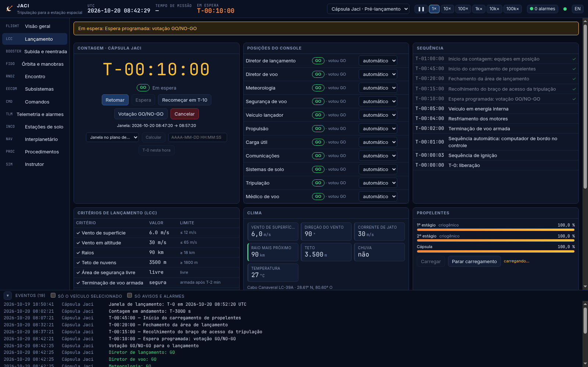
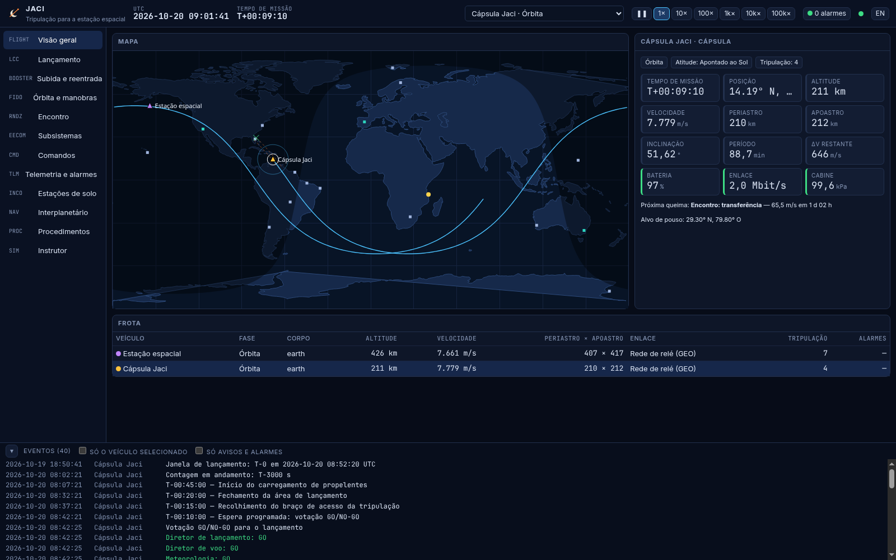
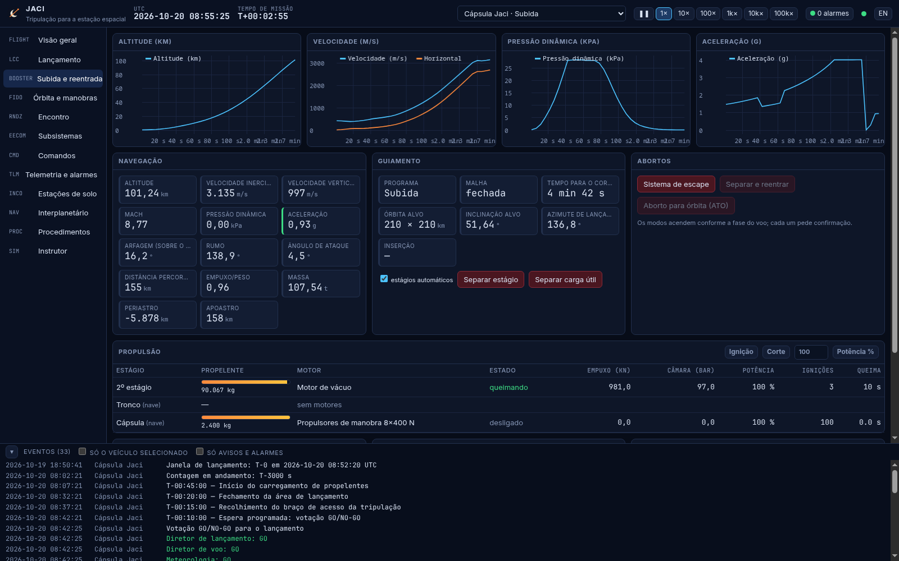
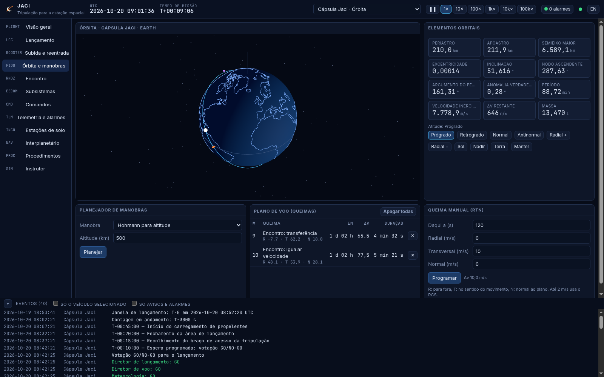
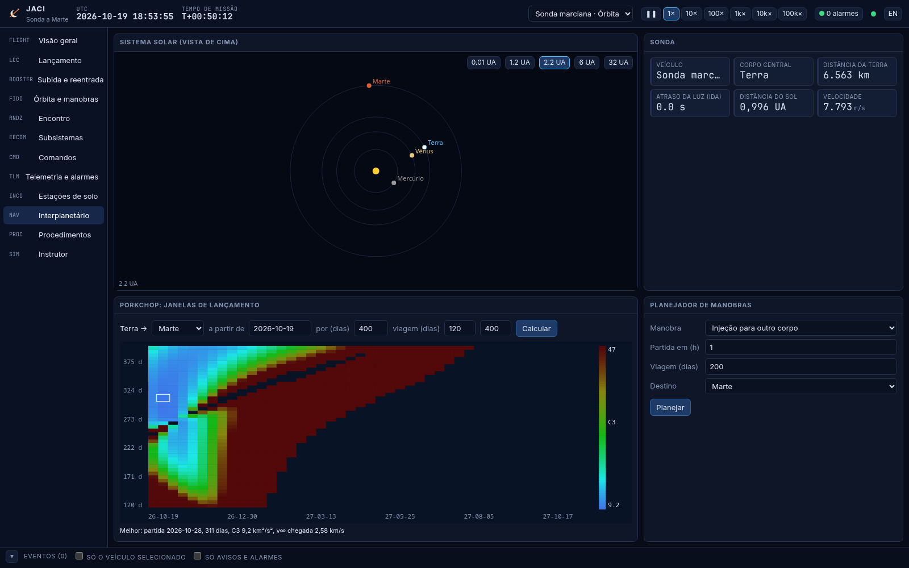
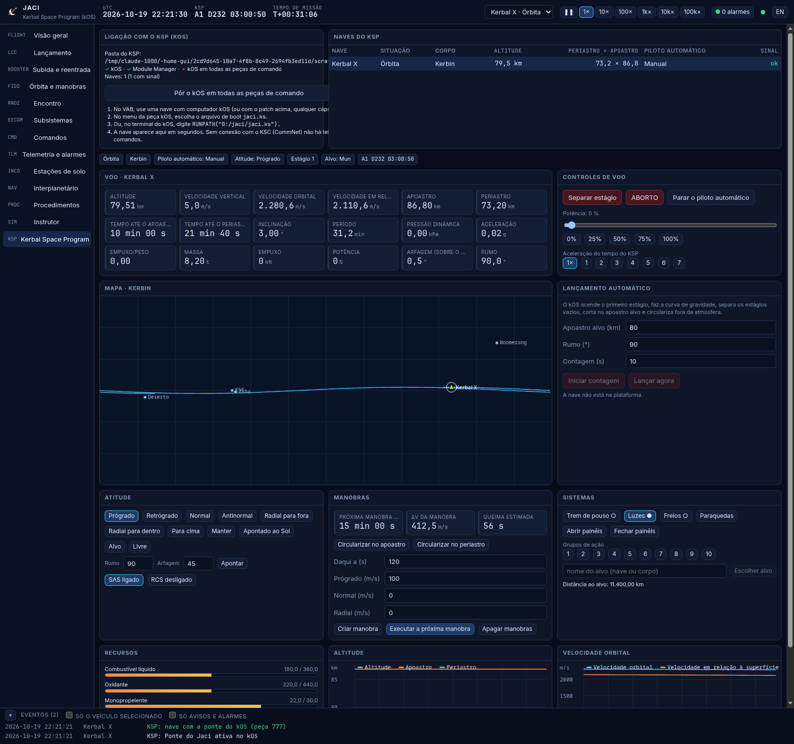

# Jaci

[](https://github.com/DrakRosmann/jaci/actions/workflows/ci.yml)

Centro de controle de missões espaciais: lançamento de foguetes, cápsulas tripuladas, ônibus
espacial, estações, satélites e sondas interplanetárias. Simula os veículos com física de verdade
(mecânica orbital, atmosfera, guiamento, subsistemas) e oferece os consoles de uma sala de
controle: contagem regressiva com votação GO/NO-GO, segurança de voo, dinâmica de voo, encontro e
acoplamento, energia, térmico, atitude, comunicações, suporte de vida, telecomando, alarmes,
estações de solo e procedimentos. Também troca telemetria e telecomando CCSDS por UDP com um
computador de bordo de verdade, e acompanha e comanda naves do Kerbal Space Program pelo kOS.

Jaci é a deusa tupi da Lua.



| Pasta | O que é |
|---|---|
| [`sim/`](sim/) | núcleo de simulação em Rust: física, veículos, guiamento, subsistemas, controle de lançamento, planejador de manobras |
| [`server/`](server/) | servidor `jaci`: roda a simulação, fala WebSocket com a interface e CCSDS por UDP; `computador-de-bordo`, um voo de demonstração com telemetria CCSDS |
| [`web/`](web/) | interface (TypeScript + React + three.js): os consoles |
| [`ksp/`](ksp/) | ponte com o Kerbal Space Program: o script do kOS (`jaci.ks`), o boot e o patch do Module Manager |
| [`docs/`](docs/) | protocolo da interface, do enlace CCSDS e da ponte com o kOS |
| [`tests/`](tests/) | teste de ponta a ponta do servidor |

## Instalar

Com Rust e Node.js 22 instalados, `./install.sh` compila e instala em `~/.local` (ou
`sudo ./install.sh /usr` para todos): os programas `jaci` e `computador-de-bordo`, a interface e um
atalho **Jaci** no menu de aplicativos, que sobe o servidor e abre o navegador (clicado de novo,
só abre o navegador). A ação "Parar o Jaci" do atalho encerra o servidor. Os estados salvos ficam
em `~/.local/share/jaci/estados`.

## Começar pelo código

Com Rust e Node.js 22 instalados:

```bash
(cd web && npm ci && npm run build)
cargo run --release --bin jaci            # abra http://127.0.0.1:8080
```

`jaci --list` mostra os cenários; `jaci --scenario tripulada` começa num deles (padrão: `sondagem`);
`--open` abre o navegador.
`--start "2026-11-05 12:00:00"` escolhe a data (padrão: agora). Para outra máquina da rede,
`--addr 0.0.0.0:8080`: sem `--token` (ou `JACI_TOKEN`), o servidor gera uma senha e mostra no log
o endereço `http://<ip>:8080/?token=…`.

Para mexer na interface com recarga automática: `cargo run --release --bin jaci` num terminal e
`npm run dev` em `web/` no outro (o Vite repassa o WebSocket para a 8080).

O endereço aceita atalhos: `/#launch` abre o console de lançamento, `/#orbit&en` o de órbita em
inglês.

## Cenários

| Cenário | O que tem |
|---|---|
| `sondagem` | VSB-30 em Alcântara: contagem desde T-10 min, dois estágios sólidos, ~6 min de microgravidade a ~240 km, separação e recuperação da carga no mar com paraquedas |
| `vlm` | VLM-1 em Alcântara: três estágios sólidos; os dois primeiros põem o apogeu na altitude da órbita, o terceiro acende na horizontal no apogeu |
| `sso` | Lançador médio (tipo Falcon 9) com satélite de observação para 752 km, 98,4°: carregamento de propelente, inserção em 200 × 752 km, segunda ignição no apogeu, separação e ativação do satélite |
| `geo` | Satélite geoestacionário para órbita de transferência (GTO) e o motor de apogeu dele |
| `tripulada` | Cápsula para 4 em Cabo Canaveral, com a janela calculada para o plano da estação; encontro e acoplamento |
| `soyuz` | Lançador com quatro boosters laterais em Baikonur, torre de escape e nave com módulo de serviço |
| `sts` | Ônibus espacial: foguetes sólidos, tanque externo, abortos RTLS/TAL/ATO/AOA, reentrada guiada e pouso em pista |
| `estacao` | Estação de 420 t com 7 tripulantes e uma cápsula acoplada: energia, térmico, suporte de vida, reimpulso e emergências |
| `retorno` | Cápsula em órbita: saída de órbita mirando o local de pouso, reentrada guiada, paraquedas e amerissagem |
| `observacao` | Satélite de observação em operação: câmera, gravador de bordo, passagens nas estações, rodas de reação |
| `marte` | Sonda e estágio de escape em órbita de estacionamento, na janela de Marte de 2026: porkchop, injeção, cruzeiro, correção e captura |
| `lua` | Sonda lunar: injeção translunar e inserção em órbita da Lua |
| `ksp` | Nenhum veículo simulado: só as naves do Kerbal Space Program (veja abaixo) |

## Consoles

* **Visão geral (FLIGHT):** mapa-múndi com continentes, noite, estações, traço previsto do veículo
  e cobertura; o estado de cada veículo da frota.
* **Lançamento (LCC):** relógio da contagem com espera programada em T-10 min, sequência (fechamento
  da área, braço da tripulação, energia interna, terminação de voo, sequência automática, ignição,
  liberação), votação GO/NO-GO das posições (lançamento, voo, meteorologia, segurança de voo,
  veículo, propulsão, carga útil, comunicações, solo, tripulação, médico) com NO-GO manual,
  critérios de lançamento (vento, raios, teto, área, tanques, motores, bateria, cabine, braço de
  acesso, sinais vitais) que seguram a contagem sozinhos, clima, carregamento e evaporação de
  propelente criogênico, janela no plano de outro veículo, segurança de voo (terminação armada,
  ponto de impacto instantâneo, corredor e terminação autônoma) e os abortos possíveis no momento.
* **Subida e reentrada (BOOSTER):** gráficos de altitude, velocidade, pressão dinâmica e
  aceleração; cada motor com estado, empuxo, pressão de câmara, potência, ignições e tempo de queima;
  guiamento (malha aberta/fechada, órbita alvo, azimute, tempo para o corte); escudo térmico,
  fluxo de calor, ablação, rolamento, paraquedas e alvo de pouso.
* **Órbita e manobras (FIDO):** vista 3D com o corpo central girando, a órbita prevista e as queimas;
  elementos orbitais; planejador (circularizar, Hohmann, apoastro, periastro, inclinação, igualar
  plano, encontro por Lambert, saída de órbita mirando o local de pouso, injeção para outro corpo,
  correção de trajetória, captura); fila de queimas; queima manual em RTN; modos de atitude.
* **Encontro (RNDZ):** estado relativo no referencial LVLH do alvo, gráfico V-bar × R-bar,
  aproximação automática até a captura, portas de acoplamento e transferência da tripulação.
* **Subsistemas (EECOM):** energia (painéis, bateria, cargas com chaves, célula a combustível),
  térmico (nós, aquecedores com termostato, radiadores), atitude (modos, rodas de reação e
  saturação, RCS, rastreador de estrelas), comunicações (estação, margem, taxa, atraso da luz,
  gravador de bordo), suporte de vida (pressão, O₂, CO₂, reservas, módulos e escotilhas) e carga útil.
* **Comandos (CMD):** dicionário com formulário gerado pelos argumentos, execução agora ou com hora
  marcada, confirmação em dois passos dos perigosos e histórico com o estado de cada comando (a
  caminho, executado, falhou). Comandos de bordo exigem enlace e chegam com o atraso da luz.
* **Telemetria e alarmes (TLM):** alarmes amarelos e vermelhos com reconhecimento; todos os pontos
  com valor, unidade e limites; gráfico dos pontos escolhidos.
* **Estações de solo (INCO):** 17 estações (Alcântara, Natal, Cuiabá, Kourou, …, e a rede de espaço
  profundo), visada ao vivo para o veículo, enlace atual e as passagens das próximas 24 h.
* **Interplanetário (NAV):** porkchop (C3 de partida e v∞ de chegada) com clique para escolher a
  janela, vista do Sistema Solar com a sonda e a trajetória, distância e atraso da luz.
* **Procedimentos (PROC):** listas de verificação que mandam comandos e esperam condições de
  telemetria (contagem, ativação de satélite, reentrada, acoplamento, despressurização, bateria
  baixa, descarga de dados, injeção interplanetária, reimpulso).
* **Instrutor (SIM):** cenários, aceleração do tempo (até 100 000×, volta a 1× num alarme), estados
  salvos, clima e injeção de falhas: motor, vazamento de propelente, célula da bateria, painel solar
  travado ou degradado, roda de reação, girômetros, rastreador de estrelas, transmissor, aquecedor,
  vazamento na cabine, remoção de CO₂, paraquedas, célula a combustível, barco na área, falha de solo
  e tempestade.
* **Kerbal Space Program (KSP):** a ligação com o jogo e o controle das naves pelo kOS (veja abaixo).

A interface está em português e inglês (botão no canto); os textos do servidor que têm tradução
também mudam.

| | |
|---|---|
|  |  |
| Cápsula recém-inserida a 210 km, no plano da estação, com o traço previsto e o ponto de queda do 1º estágio | Subida da cápsula: pressão dinâmica achatada pela redução de potência, corte do 1º estágio e malha fechada |
|  |  |
| Órbita em 3D e as queimas do encontro com a estação | Porkchop da janela de Marte de 2026 |

## A física

* **Mecânica orbital:** dois corpos com J2, elementos keplerianos, propagação em variáveis
  universais, Lambert, Hohmann, bielíptica, Clohessy-Wiltshire. Cônicas remendadas: o veículo troca
  de corpo central ao cruzar a esfera de influência (Terra, Lua, Sol, planetas).
* **Efemérides:** elementos médios de Standish (JPL, 1800–2050) para os planetas, elementos médios
  com regressão dos nodos para a Lua, tempo sideral de Greenwich, WGS-84.
* **Atmosfera:** Padrão dos EUA de 1976 até 86 km e tabela exponencial até 1000 km; vento com
  corrente de jato; atmosferas exponenciais de Marte, Vênus e gigantes gasosos.
* **Veículos:** pilha de estágios com boosters em paralelo, motores líquidos (partida, potência,
  reignição) e sólidos, empuxo que muda com a pressão ambiente, coifa, torre de escape, separação
  da carga útil; estágios largados viram detritos que caem ou ficam em órbita.
* **Guiamento de subida:** programa de arfagem em malha aberta e, no estágio superior, malha
  fechada que zera a velocidade radial na altitude de inserção, com o plano alvo e o corte pela
  energia (circular) ou pelo apoastro (elíptica); órbitas altas inserem baixo e circularizam no
  apoastro; lançadores sólidos sobem em balística e acendem o motor de apogeu. Limite de g e redução
  de potência na pressão dinâmica máxima.
* **Reentrada:** arrasto e sustentação por número de Mach, aquecimento de Sutton-Graves, escudo
  ablativo, paraquedas em estágios, guiamento por preditor que acha o rolamento para cair no alvo
  e inverte o lado para corrigir o desvio lateral, apagão de comunicações por plasma; o ônibus
  espacial plana até a pista, baixa o trem e arredonda. A saída de órbita busca, nas voltas dos
  próximos dois dias (propagando com J2), a que cai mais perto do alvo.
* **Encontro:** queimas de Lambert até 1 km atrás do alvo e aproximação final pela V-bar com o RCS.
* **Subsistemas:** balanço de energia com eclipse e distância ao Sol, bateria, célula a combustível
  e energia de solo; nós térmicos com radiação, Sol, aquecimento pelo planeta e termostatos;
  dinâmica de corpo rígido com rodas de reação, saturação e descarga; orçamento de enlace (EIRP,
  perda no espaço livre, G/T, Eb/N0) com escolha automática da taxa, ocultação pela Lua e atraso da
  luz; gás da cabine por pressões parciais, metabolismo da tripulação, remoção de CO₂, eletrólise,
  vazamento por escoamento crítico e isolamento de módulos.
* **Proteção a bordo:** modo de segurança com bateria baixa, descarga das rodas perto da saturação,
  descarga do gravador cheio, alarmes de despressurização e CO₂.

Os números dos veículos são aproximações de dados públicos daqueles em que cada um se inspira:
servem para voar de forma plausível, não para projeto.

## Enlace CCSDS com hardware

O servidor recebe telemetria e manda telecomando em pacotes CCSDS (Space Packet Protocol) por UDP:

```bash
jaci --ccsds-in 0.0.0.0:10015                  # recebe a telemetria de computadores de bordo
computador-de-bordo --server 127.0.0.1:10015   # voo de demonstração (VSB-30) mandando telemetria
jaci --ccsds-out 127.0.0.1:10016               # manda a telemetria dos simulados para outra ferramenta
```

Cada APID novo aparece como um veículo externo, com mapa, telemetria e comandos (que voltam como
pacotes de telecomando para o endereço de onde a telemetria veio). O formato está em
[`docs/protocolo.md`](docs/protocolo.md).

## Kerbal Space Program (kOS)

O Jaci acompanha e comanda naves do [Kerbal Space Program](https://www.kerbalspaceprogram.com/)
pelo [kOS](https://ksp-kos.github.io/KOS_DOC/), o mod de computadores de bordo programáveis. Um
script do kOS (`ksp/Script/jaci/jaci.ks`) roda na nave, escreve a telemetria e executa os comandos;
os dois conversam por arquivos na pasta `Ships/Script` do KSP, que é o volume `0:` (Archive) do kOS.
Não precisa de outro mod nem de rede.

```bash
ckan install kOS          # ou pelo CKAN gráfico; o Module Manager vem junto na maioria das instalações
jaci --ksp --open         # acha o KSP do Steam; ou --ksp "/caminho/do/Kerbal Space Program"
```

Também dá para ligar pela interface, no console **KSP**, ou pelo atalho "Jaci com o KSP" do menu.
Ao ligar, o Jaci copia `jaci/jaci.ks` e `boot/jaci.ks` para `Ships/Script`. Depois, no jogo:

1. Monte a nave com um computador kOS (peça *CX-4181* ou *KAL9000*). O botão "Pôr o kOS em todas
   as peças de comando" no console KSP instala um patch do Module Manager
   (`GameData/JaciKOS/jaci-kos.cfg`) que põe o computador, já com o boot do Jaci, em toda cápsula e
   sonda (vale depois de reiniciar o KSP; apague a pasta para desfazer).
2. No VAB, no menu da peça kOS, escolha o arquivo de boot `jaci.ks`; ou, já na plataforma, abra o
   terminal do kOS e digite `RUNPATH("0:/jaci/jaci.ks").`
3. A nave aparece no Jaci em segundos, como veículo do tipo "Nave do KSP".

O que dá para fazer com ela:

* **Telemetria** (5 por segundo): altitude, velocidades, apoastro e periastro com os tempos até
  eles, elementos orbitais, pressão dinâmica, aceleração, empuxo/peso, massa, empuxo, potência,
  arfagem e rumo, estágio, combustível, oxidante, monopropelente, carga elétrica (com alarme),
  combustível sólido, manobra e alvo. Entra nos gráficos, alarmes e histórico como a dos simulados.
* **Mapa e órbita** no corpo em que a nave está (Kerbin, Mun, Duna, …, inclusive os de pacotes de
  planetas), com o traço previsto e o KSC; relógio do KSP no calendário de Kerbin.
* **Lançamento automático com contagem:** a contagem corre no Jaci; no T-0 o kOS acende, faz a curva
  de gravidade, separa os estágios vazios, corta no apoastro alvo, repõe o que o arrasto tirou e
  circulariza fora da atmosfera com uma manobra que ele mesmo executa.
* **Voo:** separar estágio e aborto (com confirmação em dois passos), potência, aceleração do tempo
  do jogo, parar o piloto automático.
* **Atitude:** prógrado, retrógrado, normal, antinormal, radial, para cima, rumo e arfagem,
  manter, Sol, alvo, livre; SAS e RCS.
* **Manobras:** circularizar no apoastro ou no periastro, criar nós (prógrado, normal, radial),
  executar o próximo nó (aponta, espera, queima centrada no nó e corta no Δv) e apagar.
* **Sistemas:** trem de pouso, luzes, freios, paraquedas, painéis solares, os 10 grupos de ação e o
  alvo.

Sem conexão com o KSC (CommNet ligado e a nave sem antena ou atrás de um planeta) o kOS não chega
ao Archive: não há telemetria nem comandos, como numa perda de sinal de verdade. O kOS só roda em
naves carregadas (a ativa e as que estão a menos de ~2,5 km dela). O formato dos arquivos está em
[`docs/protocolo.md`](docs/protocolo.md); `ksp/verificar/verificar.sh` compila os scripts com o
compilador do próprio kOS, sem abrir o jogo.



## Testes

```bash
cargo test --release            # núcleo: órbitas, efemérides, atmosfera, subsistemas e voos completos
cd web && npm test              # interface: traduções
node tests/servidor.mjs         # servidor de ponta a ponta (depois de cargo build --release),
                                # inclusive a ponte do KSP com um kOS de mentira
```

Os voos completos (`sim/tests/missoes.rs`) contam, votam e lançam cada cenário e conferem o
resultado: apogeu e amerissagem do VSB-30, órbitas do VLM-1, da heliossíncrona, da GTO, da cápsula
(no plano da estação, a menos de 1°), da nave com boosters e do ônibus espacial, e a amerissagem da
cápsula a poucos km do ponto previsto. A sonda a Marte faz a viagem inteira: escolhe a partida em
que o v∞ cai no plano da órbita de estacionamento, simula a queima finita de injeção até o C3, sai
da Terra, corrige a trajetória duas vezes, chega com o periastro pedido e entra em órbita de Marte.

## Limitações conhecidas

* Cônicas remendadas: sem perturbação de terceiro corpo dentro de cada esfera de influência, e a
  Lua tem órbita média (erro de alguns graus).
* Os polos de rotação dos outros corpos estão alinhados ao eixo da Terra; latitude e longitude só são
  exatas na Terra.
* A atitude dos foguetes e dos veículos em alta aceleração do tempo é cinemática (gira com taxa
  limitada até o alvo); a dinâmica de corpo rígido vale para naves em órbita.
* O guiamento de subida não é o PEG nem o de nenhum veículo real; o RTLS do ônibus espacial é
  simplificado.
* TT e UTC são tratados como iguais (diferença de pouco mais de um minuto).
* Telemetria do veículo externo por CCSDS: só o pacote de navegação (APID 0x200).

## Créditos

Contornos dos continentes: [Natural Earth](https://www.naturalearthdata.com/) (domínio público).
Efemérides: elementos médios de E. M. Standish (JPL). Licença do Jaci: MIT.
